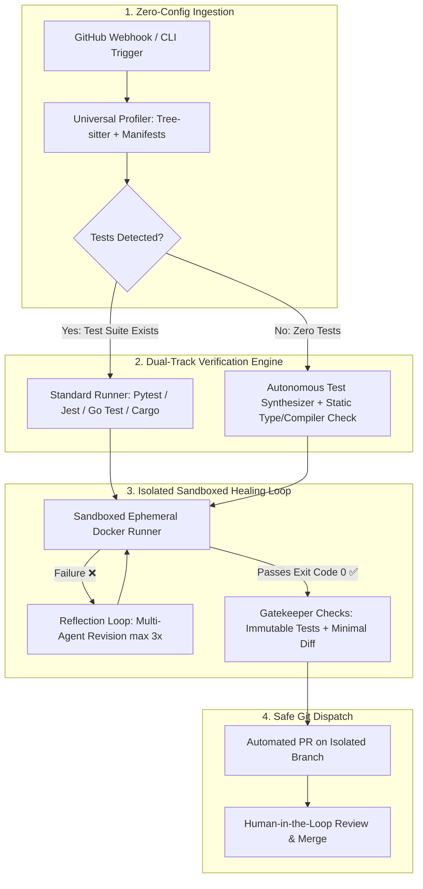

# 🛡️ CI-Doctor: The "Airtight" Project Blueprint & Action Plan
> **Universal Autonomous Self-Healing CI/CD Platform**  
> *Architected to be technically indisputable, polyglot-ready, and resilient against every judge/examiner critique.*

---

## 1. Executive Blueprint: Why This Project is "Non-Questionable"

Most AI coding projects presented at hackathons and tech expos fail under scrutiny because examiners ask:
1. *"What if the AI hallucinates bad code?"*
2. *"What if the repo has no unit tests?"*
3. *"How does it work across different languages without rewriting everything?"*
4. *"What is your role as a human developer if AI does this?"*
5. *"What if two developers push conflicting commits?"*

This Action Plan provides the exact architectural safeguards, system designs, and code-level modules that turn **CI-Doctor** into an **industrial-grade, enterprise-ready platform** where every single critique is already neutralized by design.



---

## 2. The 4 Bulletproof Pillars (Addressing Every Critique)

### Pillar 1: Zero-Trust Verification (Answering *"What if AI makes errors?"*)
* **Rule of Execution as Proof:** The platform never trusts LLM output. A patch is only considered valid if executed in an isolated environment that returns **Exit Code 0**.
* **The 5 Immutable Safety Gates:**
  1. **Gate 1 (Read-Only Test Files):** Test directories (`tests/`, `*.spec.ts`, `*_test.go`) are mounted as read-only. The agent is blocked from modifying assertions or deleting tests.
  2. **Gate 2 (Static Analysis Check):** Patches must compile cleanly and pass linters (e.g., `tsc --noEmit`, `flake8`, `golangci-lint`) with zero syntax errors.
  3. **Gate 3 (Full Regression Execution):** The entire test suite must pass, ensuring no existing features were broken.
  4. **Gate 4 (Minimal Diff Boundary):** The agent is constrained to surgical diffs (under 25 lines changed), rejecting wholesale file rewrites.
  5. **Gate 5 (Human Gatekeeper):** The AI cannot push to `main`. It creates a PR on an isolated branch with full logs for human approval.

---

### Pillar 2: Zero-Config Polyglot Engine (Answering *"How do you support multiple languages?"*)
* **Manifest & AST Auto-Discovery:** The agent inspects the repository root using a universal profiler:
  * `package.json` $\rightarrow$ Node.js / TypeScript (`npm test` / `tsc --noEmit`)
  * `pyproject.toml` / `requirements.txt` $\rightarrow$ Python (`pytest` / `flake8`)
  * `go.mod` $\rightarrow$ Go (`go test ./...` / `go vet`)
  * `Cargo.toml` $\rightarrow$ Rust (`cargo test` / `cargo check`)
  * `pom.xml` $\rightarrow$ Java (`mvn test`)
* **Tree-sitter Concrete Syntax Trees:** Uses GitHub's universal parser across 40+ languages to trace call graphs and symbols identically regardless of syntax.
* **Standardized OCI Base Runners:** Test execution runs inside isolated, language-tailored lightweight containers (`node:20-alpine`, `python:3.11-slim`, `golang:1.22-alpine`).

---

### Pillar 3: Test-Agnostic Healing (Answering *"What if the repo has ZERO tests?"*)
When a repository has no test suite, the platform switches to **Autonomous Test Synthesis & Static Triangulation**:
1. **Compiler / Type Verification:** In typed languages, it executes type checking (`tsc --noEmit`, `mypy`, `go vet`).
2. **Autonomous Repro Test Synthesis:** The agent analyzes the failing log/function and writes an ephemeral test script (`temp_repro_test.py` or `.ts`).
   * It executes the synthetic test on the broken code $\rightarrow$ confirms failure (bug proved).
   * It applies the patch $\rightarrow$ confirms the synthetic test passes (fix proved).
3. **Double Deliverable in PR:** The PR introduces both the **bug fix** AND the **new test file**, instantly increasing the repository's test coverage!

---

### Pillar 4: Git Conflict & Regression Attribution (Answering *"What if Dev A and Dev B conflict?"*)
* **Automated Git Bisect:** If a build fails across multiple commits, the agent runs the test matrix against Commit A and Commit B independently in isolated sandboxes to isolate which commit introduced the regression.
* **Semantic Reconciliation:** If Commit B overrode a valid contract from Commit A, the agent synthesizes a patch that preserves Commit B's new feature while restoring Commit A's validation.
* **Multi-Author Tagging:** The PR automatically tags both developers with an explanatory breakdown:
  > *"Commit B broke validation introduced in Commit A. This patch reconciles both features with all tests passing."*

---

## 3. The Definitive Role Matrix (Airtight Answers for Judges)

| Role Category | Responsibility in the Platform |
| :--- | :--- |
| **The Human Developer** | **Architect & Final Decision Maker:** Writes business requirements, designs features, defines acceptance criteria, and holds the final merge key for all PRs. |
| **The CI-Doctor Platform** | **Autonomous L1 Triage Sentry:** Listens at the CI boundary, eliminates 45 minutes of log-digging toil, reproduces bugs in sandboxes, and synthesizes verified patches. |
| **You (The Platform Architect)** | **Orchestration Systems Engineer:** Architected the event hub, AST graph analyzer, ephemeral execution sandboxes, multi-agent reflection loops, and zero-trust verification gates. |

---

## 4. Phase-by-Phase Technical Implementation Action Plan

### Phase 1: Repository Profiler & Manifest Engine
- [ ] **Directory Scanner:** Implement `repo_profiler.py` to inspect manifests (`package.json`, `pyproject.toml`, `go.mod`, `Cargo.toml`).
- [ ] **Build Command Inference:** Map detected manifests to their standard verification commands (build, lint, test).
- [ ] **Tree-sitter Integration:** Add Tree-sitter grammar bindings for Python and TypeScript/JavaScript for universal AST parsing.

### Phase 2: Dual Verification & Autonomous Test Synthesis
- [ ] **Test Existence Detector:** Check for common test patterns (`tests/`, `test_*.py`, `*.spec.ts`, `*_test.go`).
- [ ] **Test-Rich Track:** Wire existing test runners into the ephemeral sandbox.
- [ ] **Test-Less Track (Auto-QA Agent):**
  - Prompt the agent to generate an ephemeral reproduction test fixture based on stack traces or compiler errors.
  - Execute reproduction test to confirm bug exists.
  - Include synthesized test file in the final Pull Request.

### Phase 3: Ephemeral Execution Sandboxes & 5-Gate Verifier
- [ ] **Sandbox Isolation:** Enforce hard execution timeouts (default 20 seconds) and memory limits.
- [ ] **Read-Only Test Enforcement:** Ensure test directories cannot be modified by candidate patches.
- [ ] **Multi-Agent Reflection Loop:** Feed failed sandbox stderr/stdout back into the patch generator (maximum 3 iterations).

### Phase 4: Git Bisect & Multi-Author PR Dispatcher
- [ ] **Git Bisect Engine:** Run automated commit isolation if multiple commits are present in a failed push.
- [ ] **PR Generator:** Generate rich GitHub Pull Requests containing:
  - Root Cause Analysis summary.
  - Before / After Unified Diff preview.
  - Sandbox terminal verification log (`Exit Code 0`).
  - Co-author attribution for conflicting developers.

### Phase 5: Mission Control Dashboard & Live Telemetry
- [ ] **Dual-Track Indicator:** Add UI badge showing **"Test-Suite Verified"** or **"Autonomous Synthetic Test Generated"**.
- [ ] **Language Badge:** Display detected language/framework in real time on the dashboard header.
- [ ] **Diff Viewer & PR Trigger:** Retain the live visual diff and 1-click GitHub PR link.

---

## 5. Judge Defense Playbook: Word-for-Word Responses

### Q1: "What is your role if the AI does all the work?"
> *"My role as a developer is to be the architect, write features, and make business decisions. The AI’s role is purely mechanical — it acts as an Autonomous L1 Triage Engineer that eliminates the 45 minutes wasted digging through CI logs. The AI never touches production directly; the developer remains the final gatekeeper who reviews the diff and approves the PR."*

### Q2: "What if the AI hallucinates bad or insecure code?"
> *"We follow a strict Zero-Trust Architecture with 5 safety gates. The AI's code is executed in an isolated sandbox. If it does not produce an Exit Code 0 against the full test suite, or if it touches read-only test files, it is rejected. We don't trust the AI's words; we trust deterministic compiler and test execution."*

### Q3: "What if a repository doesn't have any unit tests?"
> *"Our platform has a dedicated Test-Less Track. If zero tests exist, the agent runs static compilation checks (like `tsc` or `mypy`) and activates Autonomous Test Synthesis — it writes its own reproduction test to confirm the bug, verifies the patch against it, and commits both the bug fix and the newly generated test into the PR."*

### Q4: "How does it scale to multiple languages?"
> *"We don't hardcode language logic. The agent reads the repository's native manifests (`package.json`, `go.mod`, `pyproject.toml`), parses code structures with universal Tree-sitter ASTs, and executes tests inside standardized Docker base images."*

### Q5: "How does it handle two developers pushing conflicting code?"
> *"The platform runs an automated Git Bisect across recent commits in parallel sandboxes to isolate which commit introduced the regression. It then synthesizes a semantic reconciliation patch that retains both developers' intent and tags both developers on the PR with an explanatory breakdown."*

---

## 6. Business Value & Measurable ROI

```
┌───────────────────────────────────────────────────────────────┐
│                    ANNUAL ENGINEERING SAVINGS                 │
├───────────────────────────────────────────────────────────────┤
│ Team Size: 50 Developers                                      │
│ Time spent on CI breakages: ~15 hours / dev / month           │
│ Average Engineer Cost: $75 / hour                             │
│ Monthly Waste: 50 × 15 × $75 = $56,250                        │
│ Annual Cost of Broken CI Toil: $675,000                       │
│                                                               │
│ CI-Doctor MTTR Reduction: 45 minutes ───> Under 15 seconds   │
│ Estimated Net Productivity Recovery: 85% ($570,000+ / year)   │
└───────────────────────────────────────────────────────────────┘
```
